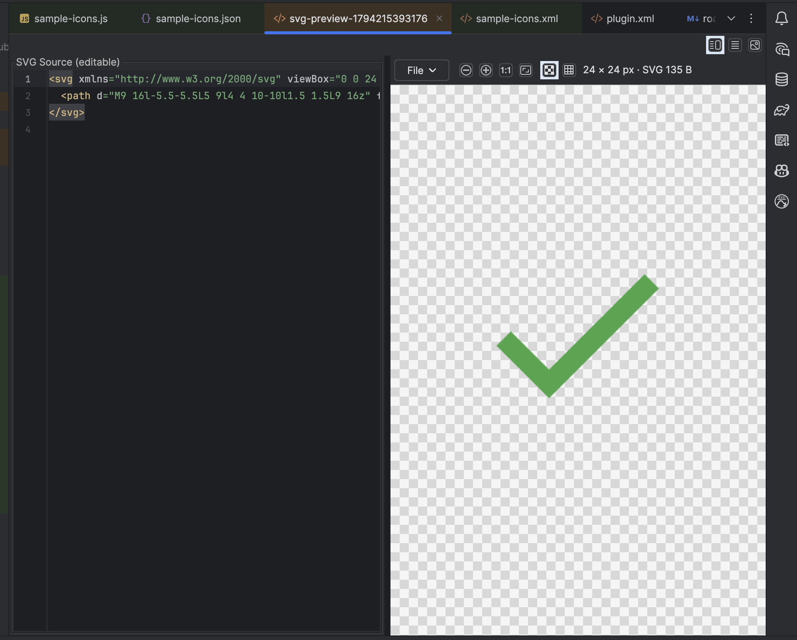
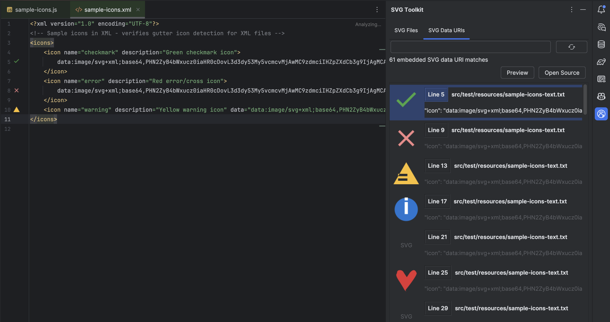
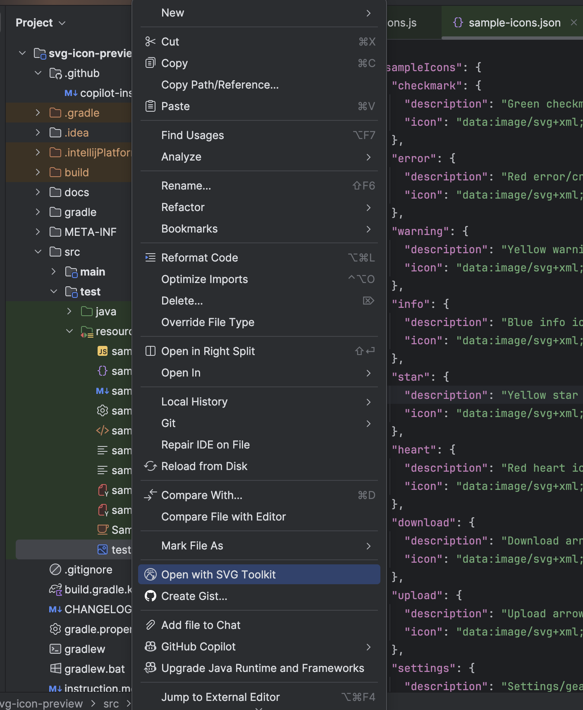
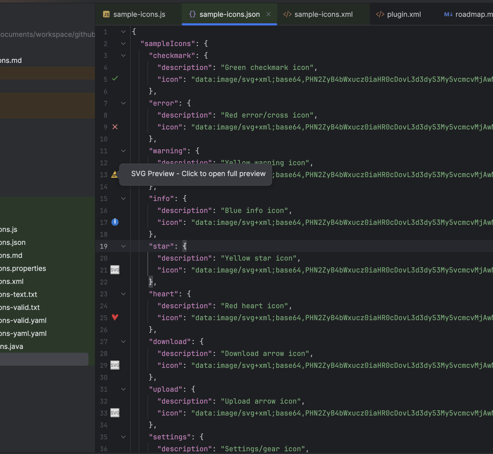
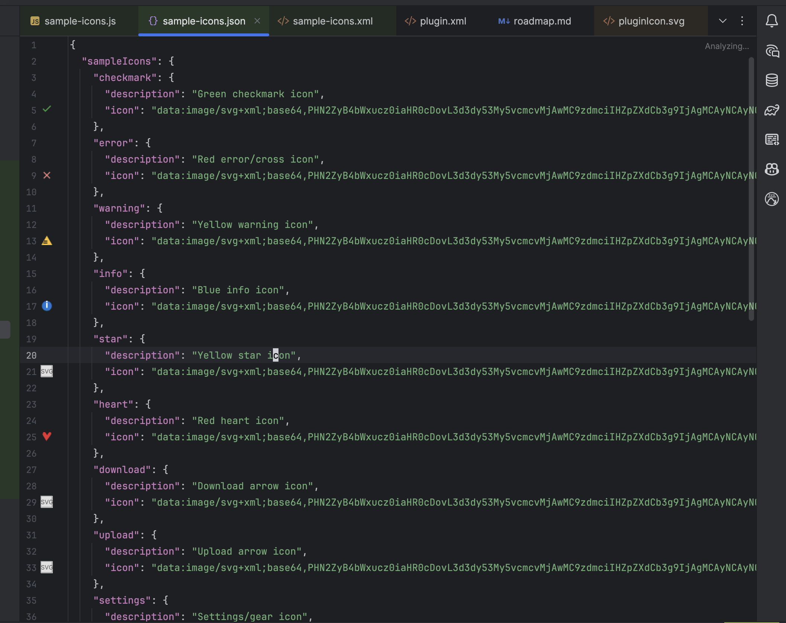
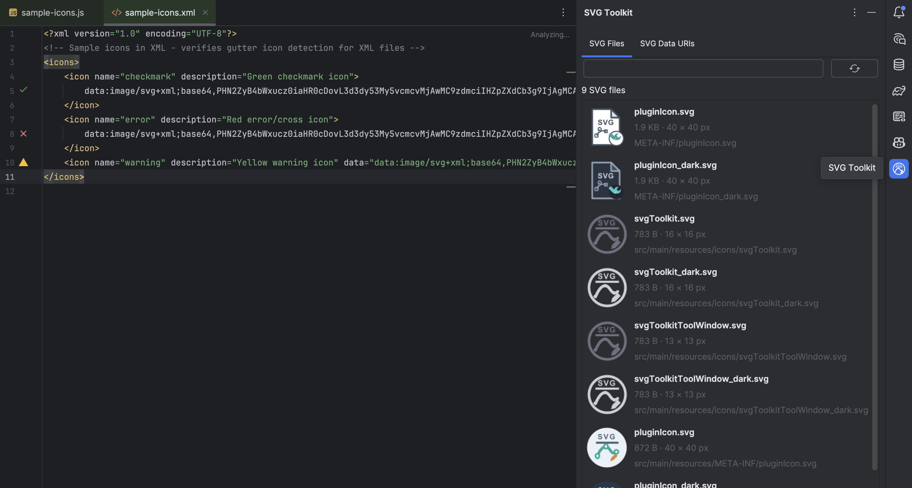
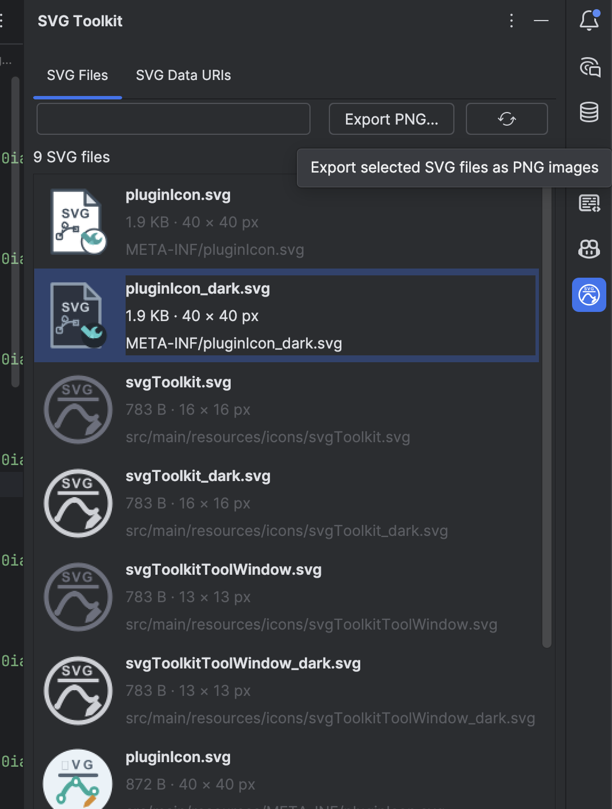
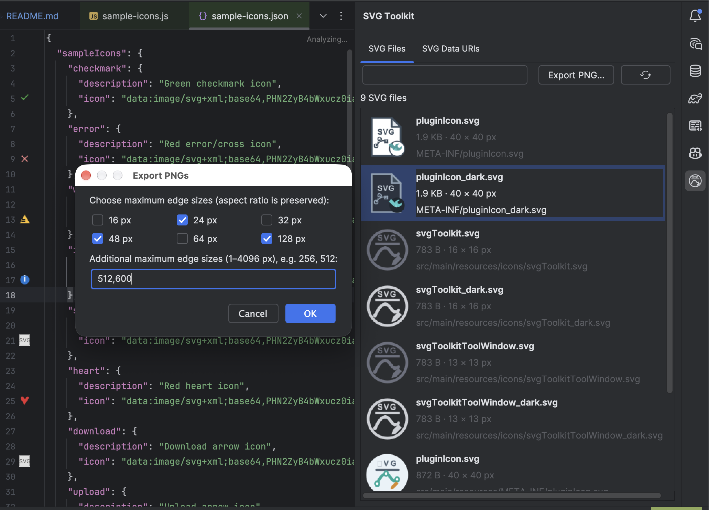
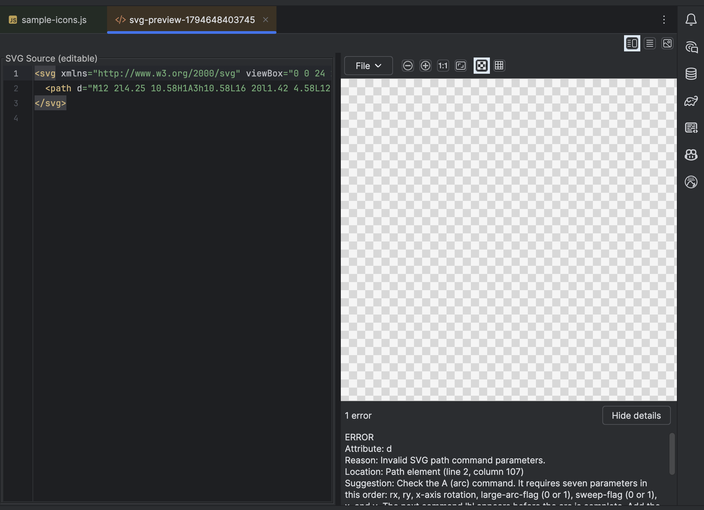

<h1 align="center">
  <br>
  SVG Toolkit
</h1>

<p align="center">
  <a href="https://plugins.jetbrains.com/plugin/32452-svg-toolkit">
    
  </a>
</p>

SVG Toolkit helps you find, preview, inspect, edit, and export SVG graphics in
IntelliJ-based IDEs. It previews SVG data URIs directly from code and provides
an editor and project browser for standalone SVG files and embedded data URIs.

- **Current stable version:** 1.4.0
- **Next planned release:** [1.5.0 — Compare and theme preview](docs/roadmap.md)
- **IDE compatibility:** IntelliJ Platform 2023.1 and later
- **Runtime:** Java 17+

## Screenshots

<table>
  <tr>
    <td align="center">
      <br>
      <sub>SVG editor</sub>
    </td>
    <td align="center">
      <br>
      <sub>Project SVG browser</sub>
    </td>
  </tr>
  <tr>
    <td align="center">
      <br>
      <sub>Embedded SVG search</sub>
    </td>
    <td align="center">
      <br>
      <sub>Open a project SVG from the Project view</sub>
    </td>
  </tr>
  <tr>
    <td align="center">
      <br>
      <sub>Gutter previews in code</sub>
    </td>
    <td align="center">
      <br>
      <sub>Browse project SVG assets</sub>
    </td>
  </tr>
  <tr>
    <td align="center">
      <br>
      <sub>Select project SVGs for batch export</sub>
    </td>
    <td align="center">
      <br>
      <sub>Choose multiple PNG output sizes</sub>
    </td>
  </tr>
  <tr>
    <td align="center" colspan="2">
      <br>
      <sub>Preview diagnostics explain SVG errors and suggest what to check</sub>
    </td>
  </tr>
</table>

## Features

### Find and preview SVGs

- Detect `data:image/svg+xml` URIs in text-based files and show gutter previews.
  Supports Java, JSON, JavaScript/TypeScript, HTML, XML, YAML, and plain text;
  decodes standard or URL-safe Base64 (including missing padding), URL-encoded,
  and plain SVG payloads with optional charset/Base64 markers.
- Browse standalone `.svg` files or search embedded SVG data URIs across
  project text files. Results include thumbnails and file/source locations.
- Search respects project content scope and exclusions and skips binary files.

### Edit and export

- Edit formatted SVG source with a live preview and split, source-only, or
  preview-only layouts.
- Review preview diagnostics for parse/render errors and non-blocking warnings
  about missing intrinsic sizing or external resource references. Diagnostics
  validate path data, explain incomplete arc commands, and provide best-effort
  attribute/element guidance for renderer errors when available. They do not
  auto-edit ambiguous SVGs or fetch external resources; double-click a located
  issue to jump to source.
- If a gutter preview cannot render, it still opens in the editor so you can
  inspect the source and renderer diagnostics.
- Embedded SVG search results also open in the editor when rendering fails, so
  their source and diagnostics remain available.
- Save changes to standalone SVG files with a check for external edits, or save
  a new SVG. Edits to data-URI previews remain local to the preview.
- Export as PNG or copy the preview as PNG or the SVG as a Base64 data URI.
- Select multiple standalone SVGs or embedded SVG data URI matches to batch-export
  PNGs at one or more maximum-edge sizes while preserving aspect ratio.

### Preview controls and performance

- Zoom, fit or view at actual size; toggle checkerboard transparency and grid.
- Rendering runs off the UI thread. Gutter previews use a bounded image cache,
  and large inline SVGs can be rendered on demand.
- Configure the maximum inline SVG size in **Settings → Tools → SVG Toolkit**.

## Installation

Install **[SVG Toolkit from JetBrains Marketplace](https://plugins.jetbrains.com/plugin/32452-svg-toolkit)**,
or in the IDE open **Settings/Preferences → Plugins → Marketplace**, search for
**SVG Toolkit**, and install it. IntelliJ will prompt you to restart the IDE to
finish installing, updating, or uninstalling the plugin. After installation or
an update, SVG Toolkit shows a one-time notification when you open a project;
select **What's New** to view the release highlights.

To install a release ZIP, use **Settings/Preferences → Plugins → Install Plugin
from Disk…**.

## Quick start

### Preview an SVG data URI from code

1. Open a text-based source file containing an SVG data URI. For example:

   ```java
   String icon = "data:image/svg+xml;base64,PHN2ZyB3aWR0aD0iMjQi...";
   ```

2. Click the SVG gutter icon to open the preview editor. It displays formatted
   SVG source beside the rendered image.
3. Edit the source and wait for the preview to refresh. Changes stay in the
   preview and do not rewrite the original code.

### Open a standalone SVG

Choose either way to open an existing `.svg` file:

- In the Project view, right-click the file and select **Open with SVG Toolkit**.
- Open **View → Tool Windows → SVG Toolkit** and use the **SVG Files** tab to
  search by filename or folder, then double-click a result or select it and
  press Enter.

The browser shows thumbnails, file sizes, dimensions when readable, and
project-relative paths. Hover over a path to see the absolute path. Use Refresh
after adding, moving, or correcting files; refresh also retries cached thumbnail
renders.

To find an embedded URI, open **SVG Data URIs**. Select a result and choose
**Preview** to open it in the editor or **Open Source** to jump to its file and
line. Reopening an already-previewed item selects its existing tab.

### Batch-export SVGs from the project browser

1. In the **SVG Files** tab, select multiple files and choose **Export PNG...**.
   The **SVG Data URIs** tab also supports selecting and exporting multiple
   embedded matches.
2. Choose one or more preset sizes or enter custom maximum-edge sizes from
   1–4096 pixels as comma-separated values (for example, `256, 512`). Aspect
   ratio is preserved.
3. Choose an output directory. PNGs are saved directly in that folder and named
   like `icon-64px.png`; duplicate standalone SVG names are disambiguated with
   their folder names. Embedded matches use the source filename, line, and
   occurrence number, such as `icons-line12-match2-64px.png`.
4. For existing PNGs, choose **Replace** or **Skip** per file, use **Replace
   All** or **Skip All** for every existing output, or cancel the export.
   Export runs in the background and reports skipped or failed files.

### Edit, save, export, and copy

For a standalone SVG, choose **File → Save** to update the original; if it
changed since opening, confirm before overwriting. Choose **Save As SVG…** to
create a separate file. For data-URI previews, edits remain local, so use Save
As SVG to write them to disk. The File menu also provides **Save As PNG…**,
**Copy as PNG**, and **Copy as Base64 data URI**.

### Adjust the preview

- Use the layout buttons above the editor to show source and preview together,
  source only, or preview only. Drag the divider in split view to resize panes.
- Check the diagnostics strip below the preview for errors and warnings. Expand
  its details and double-click an issue with a source location to navigate there.
- Use Zoom In/Out, **Actual size (1:1)**, or **Fit image to preview**.
- Hold `Ctrl` while scrolling over the preview to zoom. Keyboard shortcuts are
  `Ctrl` + `+` / `=`, `Ctrl` + `-`, and `Ctrl` + `0`.
- Toggle the checkerboard to inspect transparency or the grid to help assess
  alignment. When checkerboard is off, the preview uses the IDE theme background.

### Configure large-inline-SVG behavior

Open **Settings/Preferences → Tools → SVG Toolkit** and set the maximum inline
SVG size (10 KB–10 MB; default 200 KB). Larger inline SVGs are loaded on demand
to help keep the editor responsive.

## Requirements

- IntelliJ Platform 2023.1 or later (Community or Ultimate)
- Java 17 or later

The plugin is built against IntelliJ IDEA Community 2023.1 and declares platform
compatibility in `build.gradle.kts`.

## Build from source

```bash
./gradlew test
./gradlew build
./gradlew clean build && ./gradlew buildPlugin
./gradlew runIde
```

The plugin ZIP is generated at
`build/distributions/svg-toolkit-1.4.0.zip`.

## Project structure

```text
src/main/java/com/plugin/svg/
  action/                              Gutter provider and Project View action
  browser/                             Project browser, scanners, and thumbnail cache
  data/                                SVG data URI and XML formatting utilities
  editor/                              Preview editor, virtual files, and dimensions
  render/                              SVG renderer, image cache, and dynamic icon
  settings/                            Plugin settings UI and persistent state

src/main/resources/
  META-INF/plugin.xml                  Plugin metadata and extension registration
  icons/                               IDE action and tool-window icons
```

## Troubleshooting

**No gutter preview appears**
- Confirm the URI starts with `data:image/svg+xml`.
- Check that the payload contains valid SVG markup.
- The gutter provider scans text-based files and may skip SVGs that cannot be
  decoded.

**The project browser does not show a file**
- Confirm it is a standalone `.svg` file inside the current project content.
- Use the browser refresh button after adding or moving assets.
- Search embedded SVG data URIs in the separate **SVG Data URIs** tab.

**A large SVG is slow to preview**
- Adjust the maximum inline SVG size under **Settings → Tools → SVG Toolkit**.
- Large inline SVGs are rendered on demand to keep the editor responsive.

For plugin logs, use **Help → Show Log in Finder/Explorer** and inspect
`idea.log`.

## Plugin information

- **Plugin ID:** `com.plugin.svg-icon-preview`
- **Author:** Pramod Khalkar
- **License:** See `LICENSE`
